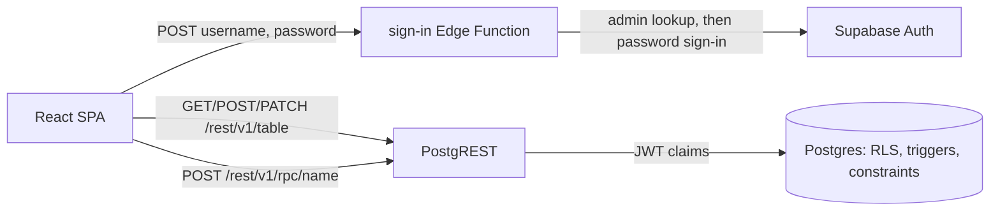

# API documentation (OpenAPI / Swagger)

[`openapi.yaml`](openapi.yaml) is an OpenAPI 3.0 description of the HTTP API the PetSwap web app uses: the `sign-in` Edge Function, six database functions (`/rest/v1/rpc/...`), and the main tables (`/rest/v1/...`). It answers the course's API-design topic (OpenAPI, Swagger, REST resource design) for a project that has no hand-written REST server.

## Why the spec looks like this

PetSwap is a single-page app on Supabase. The REST layer is generated by PostgREST from the database schema, and authorization is done by Row Level Security, not by API code ([ADR 0004](../decisions/0004-supabase-mvp-foundation.md)). So:

- A **resource** in the API is a table or a database function; the "controller" rules are RLS policies and triggers. Each operation carries an `x-rls` note saying who may call it, and the SQL tests in `supabase/tests/` verify those rules.
- The `sign-in` Edge Function is the only code the team wrote on the server side, so it is documented in full, including every error code.
- Supabase Auth and Storage endpoints are the platform's own and are only mentioned.



## View it as Swagger

Any of these, from the repository root:

```bash
docker run --rm -p 8081:8080 -e SWAGGER_JSON=/spec/openapi.yaml -v "$PWD/docs/api:/spec" swaggerapi/swagger-ui
```

then open <http://localhost:8081>. Or paste the raw file into <https://editor.swagger.io> (it is not sent anywhere you do not choose; the spec contains no secrets, only the public project URL and the public key description).

The `Quality` workflow validates the file with `openapi-spec-validator` on every pull request, so it cannot silently stop being valid OpenAPI.

## Keeping it true

- Change an RPC, a policy, or a column that the app uses: update `openapi.yaml` in the same pull request (the PR template has a checkbox for it).
- The live, generated schema of any project is also served by PostgREST at `GET /rest/v1/` with the publishable key; use it to double-check a table's columns.
- Known gaps are written into the spec where they affect behaviour (for example the pet read access for hosts), not hidden.
