# Design document

Software design document for **Don't Like My Pets (PetSwap)**, prepared for the Software Engineering final presentation (2110423). It is the single place that collects the diagrams the course taught: use case, activity, structural (ER), behavioural (sequence, state), component, and deployment diagrams, plus the quality metrics for coupling and cohesion.

Every diagram is [Mermaid](https://mermaid.js.org/), so GitHub renders it and a change to the code can change the diagram in the same pull request. Requirements are in [requirements.md](requirements.md), the module rules in [architecture.md](architecture.md), and the reasons behind the big choices in the [ADRs](decisions/README.md). This document does not repeat them; it draws them.

## 1. Context and scope

PetSwap is a pet-sitting marketplace. One account may own pets, host listings, and request bookings: there are **no fixed roles**. Payments, messaging, identity verification, availability calendars, and ratings are out of scope ([ADR 0003](decisions/0003-booking-rules-and-scope.md)).

Architecture style: a single-page web app (React, Vite, TypeScript) that talks directly to Supabase (Postgres with Row Level Security, Auth, Storage, one Edge Function). There is no application server of our own; **authorization lives in the database**, which is why the SQL contract tests matter as much as the Jest tests ([ADR 0004](decisions/0004-supabase-mvp-foundation.md)).

## 2. Use case diagram (functional model)

Actors are not roles in the data model; they are the stances one signed-in user takes. A visitor is anyone not signed in.

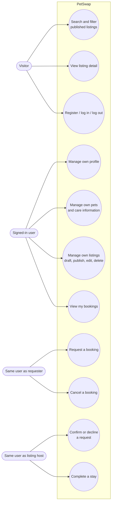

Requirement mapping: UC1 FR-4.1/4.2, UC2 FR-3.2, UC3 FR-1.1, UC4 FR-1.2, UC5 FR-2.1/2.2, UC6 FR-3.1, UC7 FR-5.1, UC8-UC10 FR-5.4, UC11 FR-5.3, and FR-5.2 (no double bookings) is a rule inside UC9.

## 3. Activity diagram: from search to completed stay

The main business process, with the system's decision points.

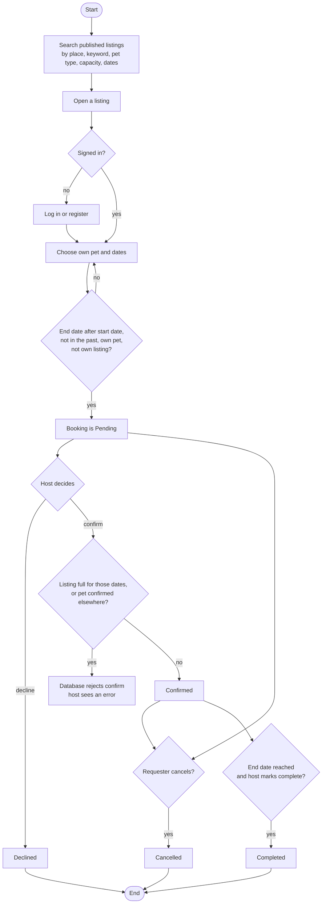

## 4. Structural model: data (ER diagram)

Derived from `supabase/migrations/`. Storage buckets (`avatars`, `pet-photos`, `listing-photos`) hold files; the tables hold only paths.

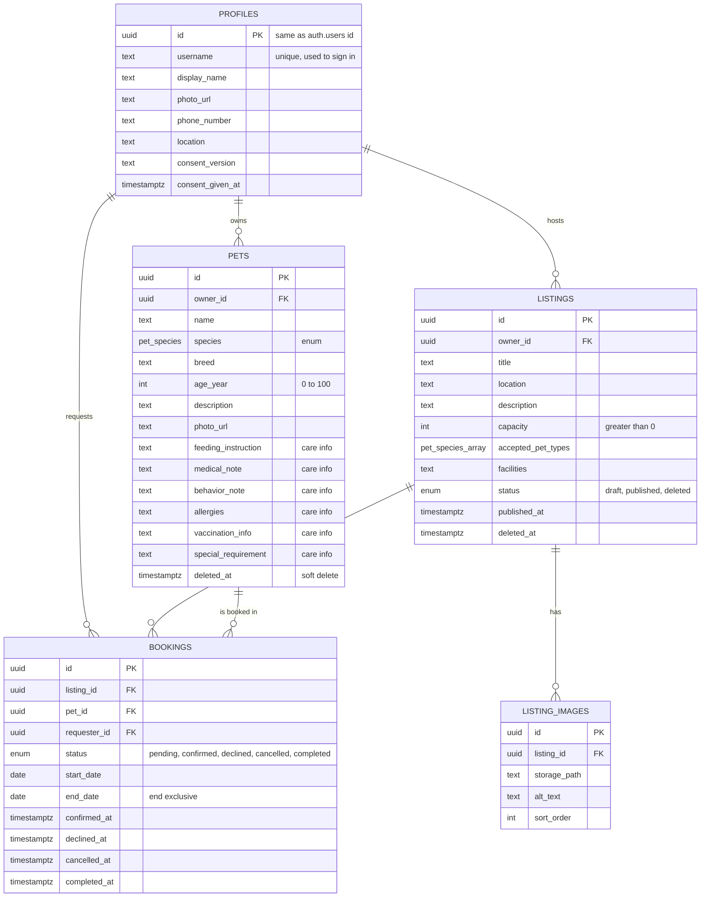

### 4.1 Class diagram: domain model and the booking rules

The domain objects mirror the tables. The two pure rule functions are shown as a utility class because they hold the business logic that is tested without a database.

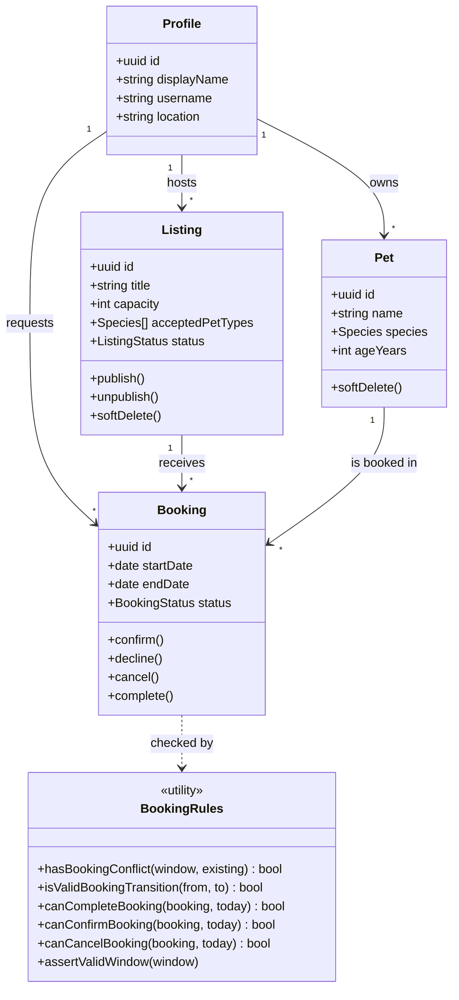

Design patterns in use: the **adapter** (each feature's `lib/*Api.ts` hides Supabase behind plain functions), **facade** (each feature's `index.ts` is the only public surface), **observer** (TanStack Query hooks and `onAuthStateChange` notify screens of data and session changes), **state machine** (booking and listing status, enforced in the database), and **guard / policy** (RLS policies and the `guard_booking_change` trigger).

Key constraints that are part of the design, not implementation detail:

- `bookings_valid_window_check`: `start_date < end_date`.
- Listing capacity: confirmed stays may overlap while the number of pets staying at once never exceeds the listing's capacity. The `zz_guard_booking_availability` trigger checks this on every confirmation under a row lock, so two hosts confirming at the same moment cannot overbook, and `guard_listing_capacity` stops capacity being lowered below confirmed stays that have not ended ([ADR 0011](decisions/0011-booking-capacity-and-pet-exclusion.md)).
- `bookings_no_confirmed_pet_overlap`: a Postgres exclusion constraint (`gist`, `daterange(start_date, end_date, '[)')`) so the same pet cannot have overlapping confirmed stays at any listings. The trigger checks this first, with a message that does not reveal the other host's dates; the constraint is the backstop. Both rules hold even if the browser is bypassed.
- `pets.id` is referenced with `on delete restrict`, and pets are soft-deleted so past bookings still show them.

## 5. Behavioural model

### 5.1 Booking state machine

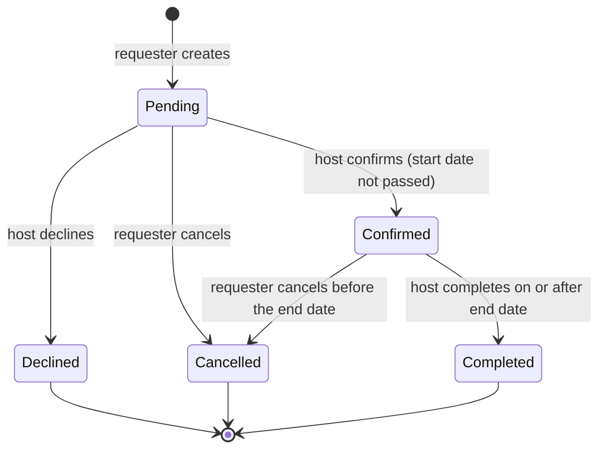

Implemented twice on purpose: `isValidBookingTransition()` in `web/src/features/bookings/lib/bookingRules.ts` (fast feedback, Jest tested) and the `guard_booking_change` trigger in Postgres (authoritative, SQL tested in `booking_lifecycle.test.sql` and `booking_transition_rules.test.sql`). Who may make each transition is decided in the trigger, not the UI. The date guards (confirm only before the start date, cancel a confirmed stay only before its end date) and the species and duplicate-request checks on creation were added in `20261114000000_tighten_booking_transitions.sql`; the UI mirrors them with `canConfirmBooking()` and `canCancelBooking()`.

### 5.2 Listing lifecycle

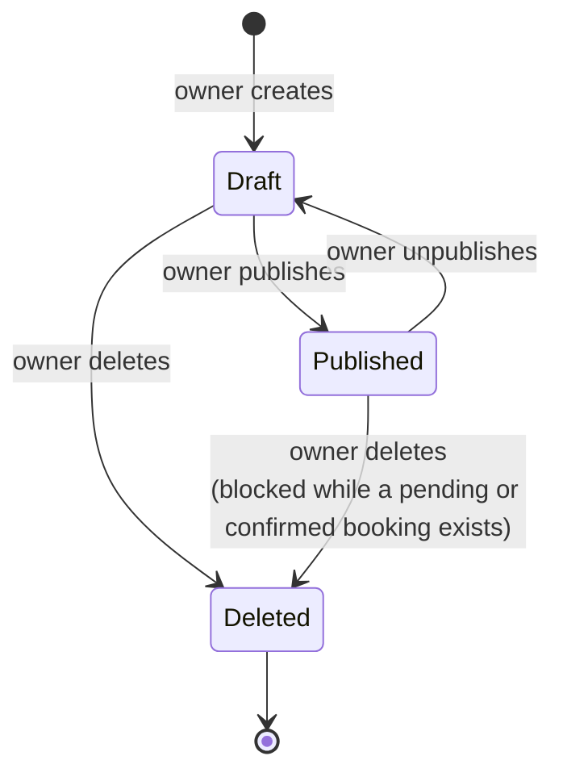

### 5.3 Sequence diagram: request a booking

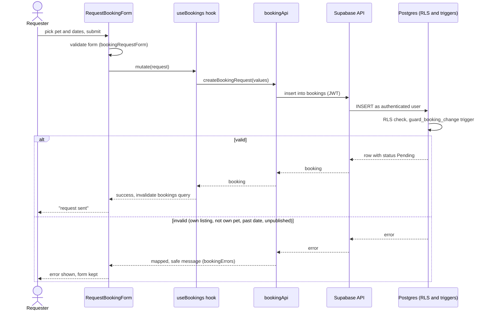

### 5.4 Sequence diagram: host confirms (double-booking protection)

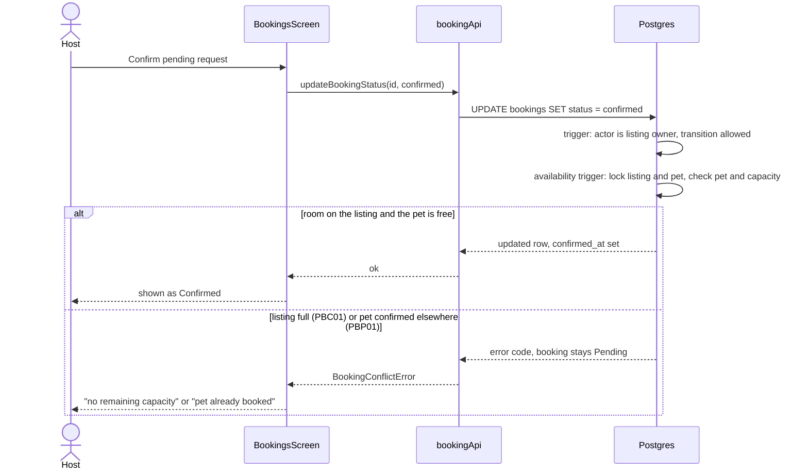

### 5.5 Sequence diagram: sign in with username

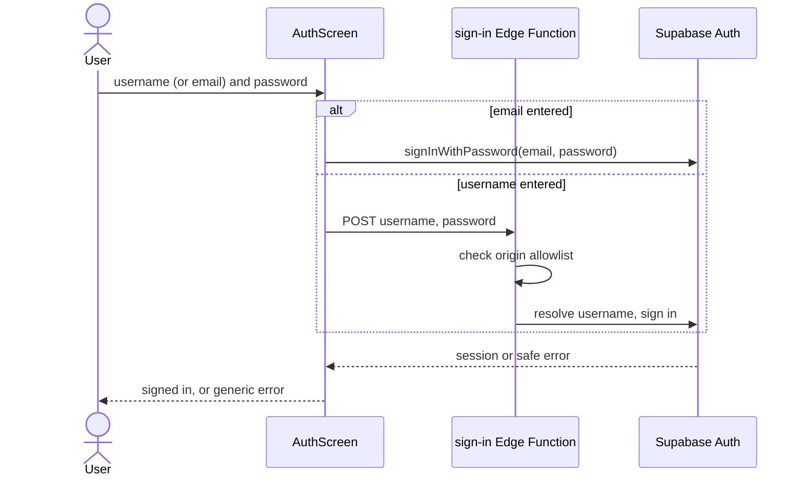

## 6. Component model

### 6.1 Runtime components

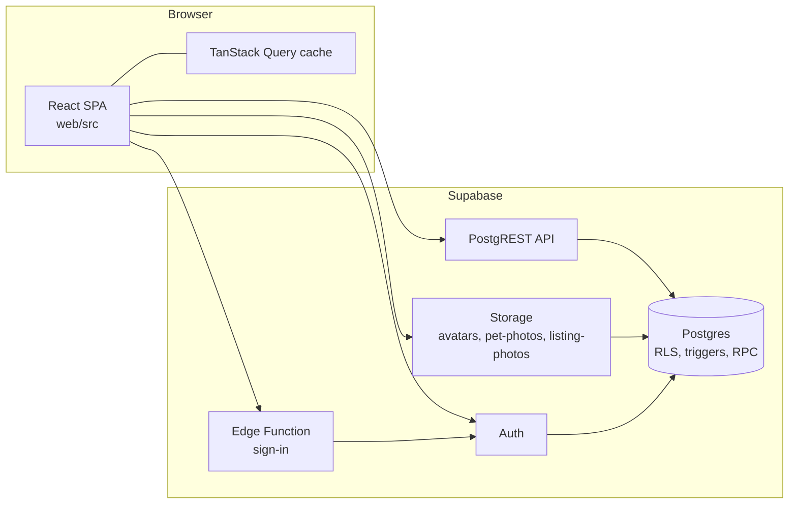

### 6.2 Front-end modules and their dependencies

Each box is a feature folder under `web/src/features/`. Arrows are real cross-feature imports counted from the source on 14 November 2026; every one goes through the other feature's `index.ts`.

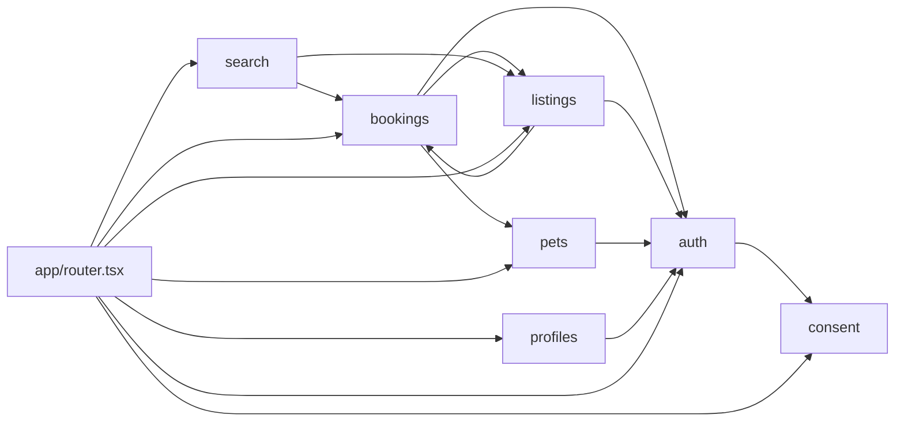

## 7. Deployment model

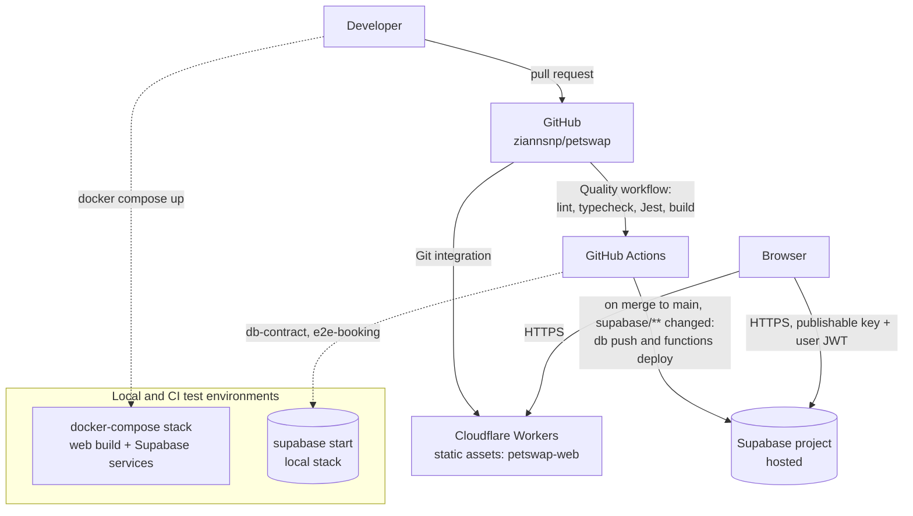

Decisions: Cloudflare Git integration deploys the web app and GitHub Actions deploys only Supabase ([ADR 0005](decisions/0005-cloudflare-workers-hosting.md)); the full stack runs locally in Docker ([ADR 0008](decisions/0008-docker-compose-stack.md)); rollback is a Cloudflare version promotion, which is why migrations must be expand/contract ([ci-cd.md](ci-cd.md#rollback)).

## 8. Design principles applied

| Principle | How PetSwap applies it | Evidence |
| --- | --- | --- |
| High cohesion | Everything a feature needs (UI, hooks, pure rules, API adapter, types) sits in one folder | `web/src/features/*`, [ADR 0001](decisions/0001-web-spa-feature-architecture.md) |
| Low coupling | Cross-feature imports only via `index.ts`; Supabase calls only in adapters, never in components | [architecture.md](architecture.md), lint-enforced (see section 9) |
| Information hiding | Pure business rules (`hasBookingConflict`, `isValidBookingTransition`) are tiny, dependency-free functions | `bookingRules.ts` |
| Defence in depth | Browser validation gives feedback; the database enforces ownership, capacity, and pet availability | RLS, triggers, exclusion constraint |
| Least privilege | `security definer` search RPC with an empty search path, no booking details returned | [ADR 0010](decisions/0010-listing-search-availability-privacy.md) |
| Expand/contract changes | Forward-only migrations so a Worker rollback still works | [ci-cd.md](ci-cd.md#rollback) |

## 9. Quality metrics: coupling and cohesion

Measured on 14 November 2026 from the source (feature folders only).

| Feature | Imports from other features (efferent) | Imported by (afferent) | Reading |
| --- | --- | --- | --- |
| auth | 1 (consent) | 4 | Stable foundation: many dependants, few dependencies |
| consent | 0 | 1 | Leaf, fully self-contained |
| pets | 1 (auth) | 1 | Low coupling |
| profiles | 1 (auth) | 0 | Low coupling |
| listings | 2 (auth, bookings) | 2 | Moderate |
| bookings | 3 (auth, pets, listings) | 2 | Highest efferent coupling; expected for the domain's centre |
| search | 2 (listings, bookings) | 0 | Pure consumer |

Findings worth stating honestly:

- **Boundary rule holds.** No file reaches into another feature's internals; every cross-feature import uses `index.ts`. This is now checked automatically by ESLint rather than by convention alone.
- **One cycle: `listings` and `bookings` import each other.** This is a mild design smell (a dependency cycle between two modules), and a candidate refactor: move the shared listing-summary type or the "request booking" entry point so only one direction remains. It is recorded rather than fixed because it works and touches two squads' code; see [sqa-scm-plan.md](sqa-scm-plan.md#measurement).
- `bookings` has the most outgoing dependencies, which matches its role as the aggregate of listing, pet, and requester.

## 10. User interface design

The UI was prototyped first (course topic: prototyping and UI design) as a separate reference app, "VibeCode", owned by Team A. Feature work follows it for layout, navigation, empty/loading/error states, and visual tokens; the contract and the language decision (English copy) are in [design.md](design.md).

Navigation structure, from the router (`web/src/app/router.tsx`):

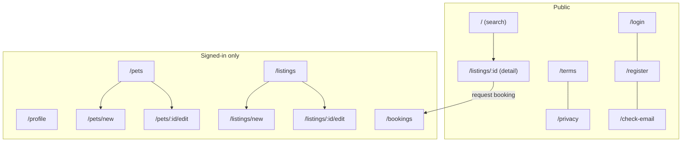

Usability and quality rules applied: every form keeps the user's input on error, destructive actions use a confirmation dialog with focus returned to the trigger, layouts are verified on desktop and mobile, and failures show safe messages that do not expose private data. Evidence: [qa/](qa/).

## 11. Known limitations of the design

- Listing creation is a client-orchestrated sequence across Postgres and Storage, not a transaction; see [architecture.md](architecture.md#listing-creation-consistency).
- The app has no REST layer of its own, so the API is the generated Supabase API plus one Edge Function. It is described in OpenAPI 3.0 in [api/openapi.yaml](api/README.md) (viewable in Swagger UI), with each operation's access rule noted.
- The ER diagram is hand-maintained; regenerate it from the migrations when the schema changes.
