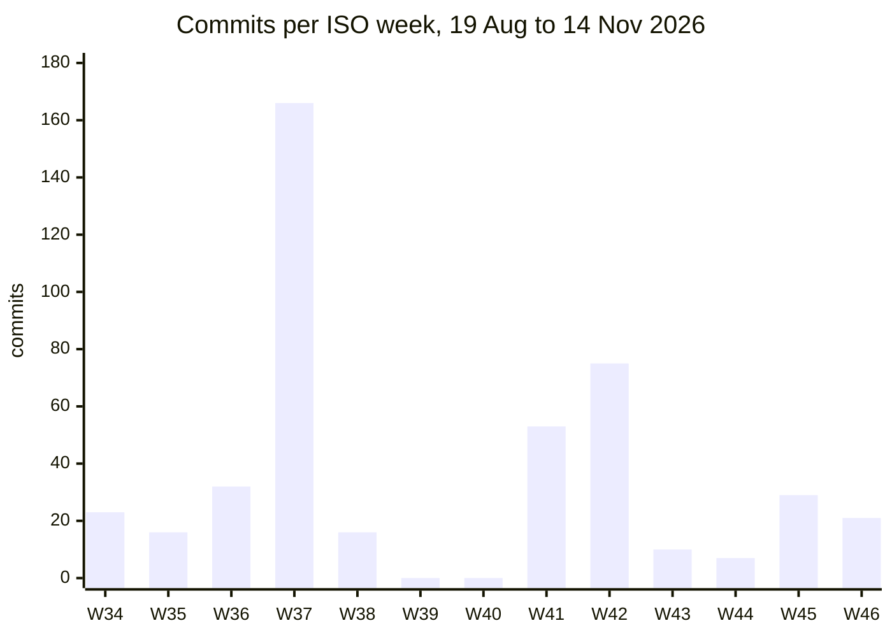

# Project management plan

Planning, scheduling, estimation, resource, and risk record for PetSwap, written for the Software Engineering project (course outcomes: manage a software project including planning, scheduling, and cost estimation; risk and change management). The live backlog, sprint backlog, burndown chart, and daily-meeting notes stay in the team Google Sheet, which is the source of truth for delivery tracking ([team-protocol.md](team-protocol.md)); this document holds the durable plan around it.

## 1. Development model

| Question | Choice | Why |
| --- | --- | --- |
| Life-cycle model | Scrum (agile, iterative), three time-boxed sprints | Requirements were still being shaped, a team of ten needs short feedback loops, and the course schedule has three demo checkpoints. A waterfall plan would have put all integration risk at the end. |
| Architecture driver | Backend-as-a-service (Supabase) plus a single-page app | Smallest amount of custom server code for a student team; authorization moves into Row Level Security ([ADR 0004](decisions/0004-supabase-mvp-foundation.md)). |
| Quality approach | Test pyramid with CI gates, peer review on every change | See [test-plan.md](test-plan.md) and [sqa-scm-plan.md](sqa-scm-plan.md). |

Scrum roles: the product owner role is held by the team's requirements ([requirements.md](requirements.md)); each squad appoints a mini Scrum Master who keeps its cards current; a Scrum / Infra owner runs ceremonies support and burndown. Ceremonies: squad daily scrums Monday and Thursday, a shared Sunday delivery session, a whole-team demo every two weeks, and a sprint review at each course presentation.

## 2. Scope

In scope: accounts and profiles, pets and care information, listings, search and filters, bookings and their lifecycle. Out of scope: payments, messaging, verification, availability calendars, ratings ([ADR 0003](decisions/0003-booking-rules-and-scope.md)). Scope changes go through the change process in section 8.

Work breakdown (top two levels), with the owning squad:

| WBS | Work package | Squad |
| --- | --- | --- |
| 1 | Accounts and pets: authentication, profiles, pet profiles, care notes | A |
| 2 | Listings and search: listing CRUD, photos, detail, search and filters | B |
| 3 | Booking management: request, conflict prevention, lifecycle, completion | C |
| 4 | Quality, testing and release: CI, test harnesses, seed data, regression, Docker, deployment, security checks | Team D |
| 5 | Project management and documentation: backlog, burndown, design document, test plan, ADRs | All, Team D coordinates |

## 3. Schedule

Milestones are the course checkpoints; sprint boundaries follow them.

| Sprint | Window | Checkpoint | Focus |
| --- | --- | --- | --- |
| Planning | to 25 Aug 2026 | Product backlog and Sprint 1 backlog presented | Requirements, architecture, environments |
| Sprint 1 | 25 Aug to 15 Sep | Software for Sprint 1, Sprint 2 backlog | Foundations: auth, schema, first screens, CI gate |
| Sprint 2 | 15 Sep to 20 Oct | Software for Sprint 2, Sprint 3 backlog | Listings, pets, search, booking lifecycle, Docker, deployment |
| Sprint 3 | 20 Oct to 17 Nov | Software for Sprint 3, design document, test plan, demo | Search filters, email confirmation, hardening, security and quality checks, final documents |
| Closing | 17 to 27 Nov | Final exam 27 Nov | Release-readiness note, retrospective |

Activity by week, from the commit history (all branches merged to `main` plus feature work):

Weeks 39 and 40 (end of September to early October) show no commits: that is the midterm period and the 29 September online class. The week-37 spike is the Sprint 1 to Sprint 2 integration push before the 15 September presentation.

## 4. Effort and cost estimation

### 4.1 COCOMO II (post-architecture, nominal drivers)

Size is measured, not guessed. Non-blank source lines on 14 November 2026:

| Part | Lines |
| --- | --- |
| Application code (`web/src` TypeScript and TSX, `supabase/functions`), excluding tests and generated database types | 9,433 |
| SQL migrations | 1,855 |
| **Production size** | **11,288 = 11.29 KSLOC** |
| For comparison: automated tests (Jest, Playwright, SQL tests) | 12,274 + 4,080 = 16,354 |

Calculation with all scale factors and effort multipliers at nominal (scale-factor sum 18.97, so exponent E = 0.91 + 0.01 x 18.97 = 1.0997):

- Effort PM = 2.94 x 11.29^1.0997 = **42.3 person-months** (about 6,400 hours at 152 hours per person-month).
- Schedule TDEV = 3.67 x PM^(0.28 + 0.2 x (E - 0.91)) = 3.67 x 42.3^0.318 = **12.1 months**.
- Average team size implied = PM / TDEV = about 3.5 full-time people.

### 4.2 Comparison with actual effort

The team commits at least 3 hours per person per week ([team-protocol.md](team-protocol.md)). Over the 12.9 weeks from the first commit (19 Aug) to the final presentation, 10 people at the minimum commitment give about **386 hours, 2.5 person-months**, which is roughly 6 percent of the model's estimate.

Reading the gap honestly:

- COCOMO II is calibrated on full-time professional teams delivering from scratch; this is a part-time student team and the time-box is 13 weeks, not 12 months.
- Supabase generates the REST API, authentication, and storage, so a large part of a normal back end is not code the team wrote or estimated.
- AI-assisted development is in use and documented ([conventions.md](conventions.md)); it raises output per hour, and the measured lines include generated test code.
- The 3 hours is a floor; real hours are higher and are visible in the Sheet's burndown, which tracks task hours.
- The useful result is the order of magnitude and the ratio of code to test (about 1 : 1.4 by lines), not the absolute figure. For future work the team should calibrate with its own measured velocity from the burndown rather than with nominal COCOMO constants.

### 4.3 Money cost

There is no staff cost (students) and no revenue. Recurring cost items to keep visible: the hosted Supabase project, Cloudflare Workers hosting, the GitHub repository and Actions (public repository, so Actions minutes are free), and domain names if any. Their plan tiers and bills are held by the platform account owner ([ci-cd.md](ci-cd.md#ownership-and-access)); record the actual tier and monthly amount in the release-readiness note before the presentation if the teacher asks for a figure.

## 5. Resources

| Resource | Allocation |
| --- | --- |
| People | 10 members in four squads (three feature squads and a QA / Scrum / Infra squad), at least 3 hours per member per week |
| Tools | GitHub (repo, Actions, reviews), Supabase (hosted project and local CLI), Cloudflare Workers, Docker, Playwright, Jest, Google Sheet, Discord |
| Environments | Local Supabase, CI runner, Docker Compose stack, one shared hosted project; see [environments.md](environments.md) |
| Knowledge | Onboarding path in [getting-started.md](getting-started.md); conventions and ADRs |

## 6. Risk register

Probability and impact are rated Low, Medium, High. "Status" is as of 14 November 2026. Items marked "happened" are real events from the project history, kept because they show the mitigation worked.

| ID | Risk | P | I | Mitigation and contingency | Owner | Status |
| --- | --- | --- | --- | --- | --- | --- |
| R1 | Overlapping confirmed bookings (core business rule broken) | M | H | Exclusion constraint in Postgres plus a pure, tested helper; SQL and Playwright tests | Squad C | Controlled |
| R2 | A user reads or changes data they should not (RLS gap) | M | H | RLS on every table, actor-based SQL tests per state change, database lint, review focus on policies | All, Team D checks | **Happened** (host kept pet access after declining; found 14 Nov, fix and regression test in progress) |
| R3 | Tool upgrade breaks CI (Supabase CLI v3 rejected `config.toml`) | M | M | CLI version pinned from the lockfile; Dependabot proposes upgrades as reviewable PRs | Team D | **Happened** 2 Nov, fixed and prevented |
| R4 | Shared hosted database used by previews, so review data is real | H | M | Documented as accepted in [environments.md](environments.md); revisit with a staging project | Team D | Accepted |
| R5 | A red workflow can still be merged because `main` requires no status checks | M | M | Team rule; seven required checks and a ruleset file to apply ([ci-cd.md](ci-cd.md#required-checks)); release gate on `Supabase DB Push`; CODEOWNERS for review routing | Team D with repo owner | Mitigation ready (US-D.5); closes when the repo owner applies the ruleset |
| R6 | A test exists but never runs in CI | M | M | Loop over every SQL test file; guard that fails if a Playwright spec is run by no workflow | Team D | Mitigation added |
| R7 | Vulnerable dependency or committed secret | L | H | Dependabot, dependency review, CodeQL, secret scanning and push protection | Team D | Mitigation added |
| R8 | Cross-feature coupling grows into cycles (one exists between `listings` and `bookings`) | M | M | ESLint boundary rule; coupling table reviewed each sprint; planned refactor | Squads B and C | Open, recorded |
| R9 | Exams and holidays reduce capacity (midterm week showed no commits) | H | M | Sprint scope sized to a 3-hour weekly floor; Sunday shared session; cut lowest-priority cards first | Scrum owner | Controlled |
| R10 | Image-pull rate limits break the Docker health check | M | L | Check kept informational; retry; documented | Team D | Accepted |
| R11 | Browser-orchestrated listing creation can leave orphan drafts or files | L | M | Best-effort cleanup, drafts are private, noted as a production follow-up | Squad B | Accepted, documented |
| R12 | Key person unavailable | M | M | Conventions, ADRs, getting-started guide, no single-owner files, CODEOWNERS lists squads rather than individuals | All | Controlled |

## 7. Communication and monitoring

- Progress: burndown chart and sprint backlog (Google Sheet), reviewed at each daily scrum and sprint review.
- Evidence of daily meetings: chat captures or photos linked from the Sheet, as the course asks at each presentation.
- Work distribution: GitHub Insights, Contributors graph, plus the summary in [team-collaboration.md](team-collaboration.md).
- Quality status: CI checks on every pull request; QA evidence in [qa/](qa/).

## 8. Change management

1. A change to scope starts as a card or issue in the backlog, never as silent expansion of a pull request.
2. If the change affects architecture or a product rule, the author applies the ADR decision tree ([decisions/README.md](decisions/README.md)) and adds an ADR.
3. Requirements changes update [requirements.md](requirements.md) in the same pull request as the code.
4. Schema changes ship as forward-only migrations using expand/contract, so a rolled-back web version still works ([ci-cd.md](ci-cd.md#rollback)).
5. Every change is reviewed by one other person and passes the required checks before merge.
