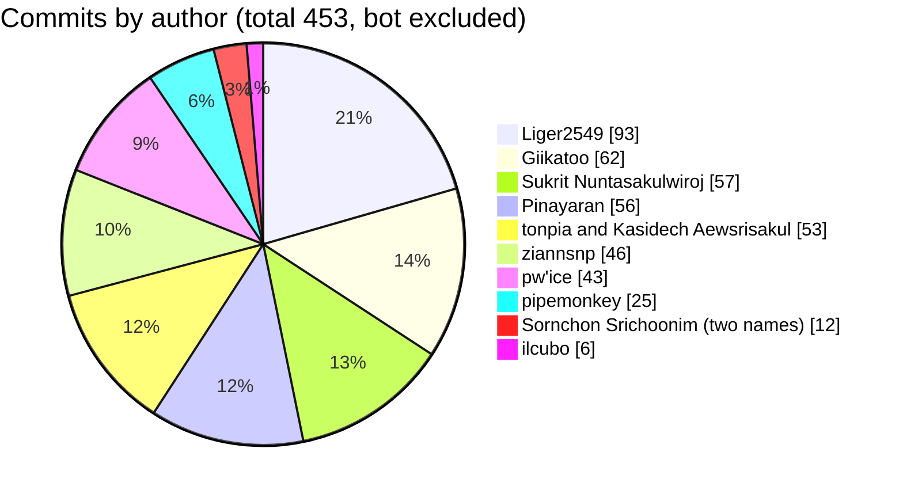

# Team collaboration evidence

Evidence that work was shared across the team (course outcome: demonstrate team collaboration in a software project). The course presentation asks for burndown, daily-meeting evidence, and the GitHub contribution graph; this page holds the repository-derived part and says where the rest lives. Figures are from `git log` and the GitHub API on 14 November 2026 and can be regenerated at any time.

## Contribution by author

Commits on all branches since the first commit (19 August 2026), by git author name. One author can appear under more than one name because of different git configurations, and a squash merge credits the merger for some commits, so use this as a shape, not an audit.



Merged pull requests by author (91 merged by 14 November), which shows review-based integration rather than direct pushes:

| Author | Merged PRs |
| --- | --- |
| tonpia | 17 |
| Liger2549 | 16 |
| Suk-Nsr | 14 |
| ziannsnp | 11 |
| Pinayaran | 10 |
| Giikatoo | 8 |
| pipemonkey | 6 |
| pwaii | 6 |
| sornchon | 2 |
| ilcubo | 1 |

All ten people have merged work, and 274 review events are recorded on those pull requests. Direct pushes to `main` are blocked by the branch ruleset ([ci-cd.md](ci-cd.md#main-branch-protection)).

## Work split by squad

Squad ownership and responsibilities are in [team-protocol.md](team-protocol.md): A accounts and pets, B listings and search, C bookings, D quality, testing and release. Feature squads write their own tests, and Team D owns the standard and the CI gates ([testing.md](testing.md#who-writes-the-tests)).

## Practices that show collaboration

| Practice | Evidence |
| --- | --- |
| Short-lived branch per card, pull request to `main`, one approval | Branch ruleset; PR template; merged PR history |
| Reviewer focus section and evidence checklist in every PR | `.github/pull_request_template.md` |
| Decisions recorded, not just discussed | 10 ADRs in [decisions/](decisions/README.md) |
| Cross-squad help without taking over ownership | Team D tests and fixes on request ([testing.md](testing.md)); regression passes in [qa/](qa/) |
| Daily scrums, Monday and Thursday; Sunday shared session; biweekly whole-team demo | [team-protocol.md](team-protocol.md#cadence) |
| Code ownership routes review to the owning squad | `.github/CODEOWNERS` |

## Evidence that lives outside the repository

- **Burndown chart, sprint backlog, daily scrum notes:** team Google Sheet (see [project-management-plan.md](project-management-plan.md#7-communication-and-monitoring)).
- **Daily meeting evidence:** chat captures or photos, linked from the Sheet; attach them to the presentation slides.
- **GitHub contribution graph:** repository, Insights, Contributors; screenshot it for the slide because it is live and changes after the presentation.

## Regenerate this page's numbers

```bash
git log --format='%an' | sort | uniq -c | sort -rn
gh pr list --state merged --limit 300 --json author --jq '[.[]|.author.login]|group_by(.)|map({a:.[0],n:length})|sort_by(-.n)'
```
